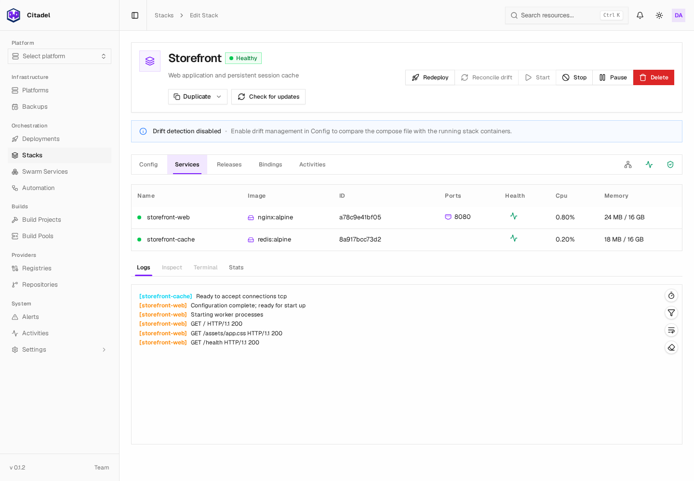
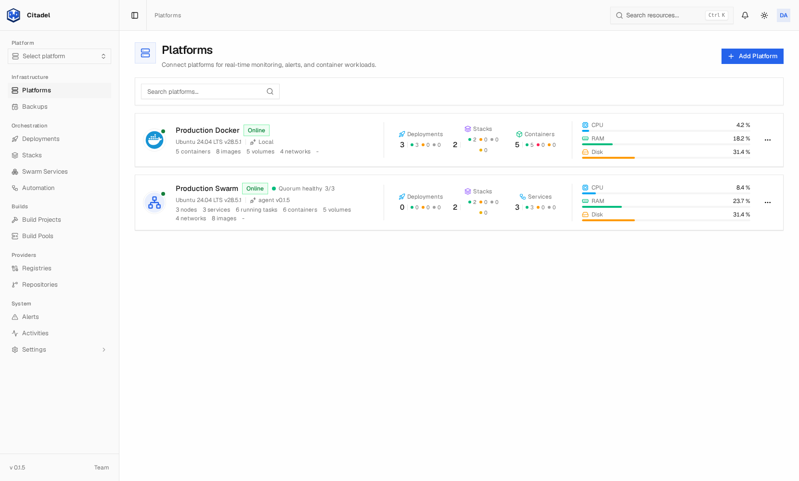
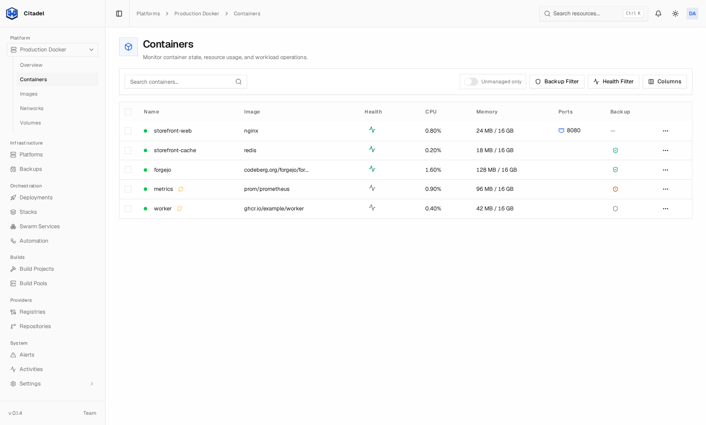
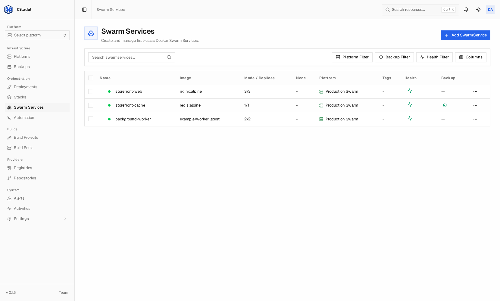
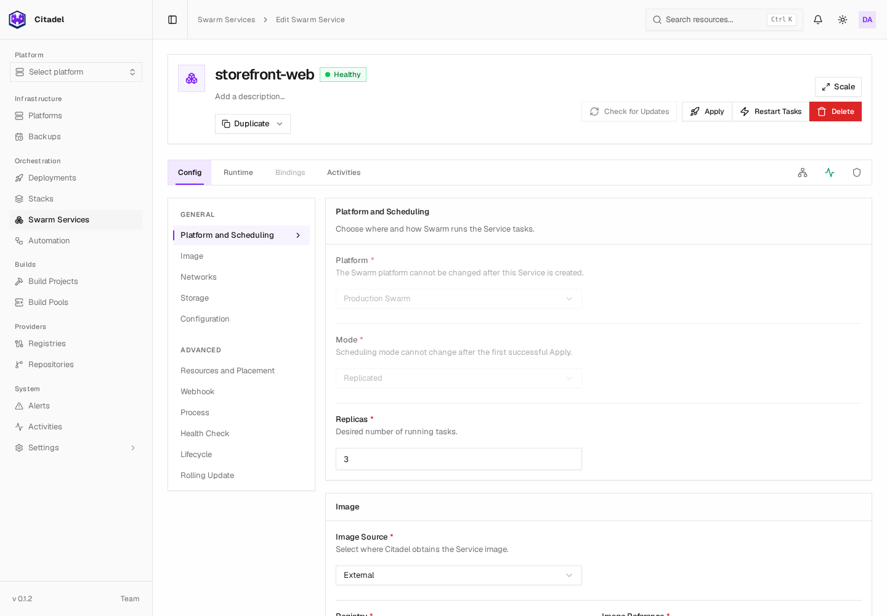
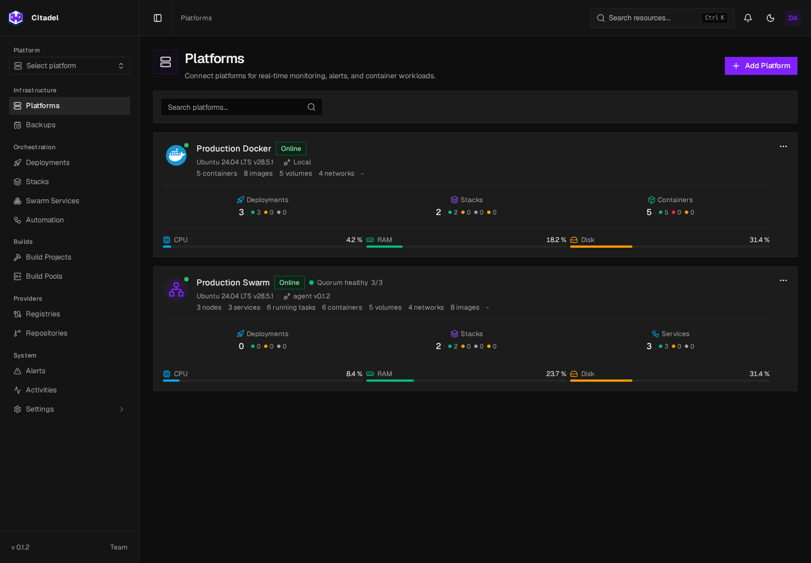

  

<h1 align="center">Citadel</h1>

  <strong>A self-hosted management platform for Docker and Swarm.</strong>

Build images from Git, deploy containers and Compose stacks, and manage Docker Standalone and Swarm across multiple hosts through one web interface.

[Live demo](https://demo.citadelplane.com/) · [Documentation](https://docs.citadelplane.com/) · [Report an issue](https://github.com/Citadel-P/Citadel/issues)

## What Citadel does

- **Deploy applications** — build images from Git, publish to registries, deploy containers and Compose stacks, and roll back releases.
- **Manage hosts and Swarm** — connect local Docker, remote Agents, and outbound Edge Agents; manage nodes, services, tasks, configs, and secrets.
- **Inspect workloads** — follow logs, open terminals, and track resource usage.
- **Back up and restore** — protect the control plane, Docker volumes, and supported bind mounts with scheduled backups, retention policies, and restore workflows.
- **Automate operations** — run TypeScript actions, schedule work, respond to webhooks, and check configuration drift.
- **Control access** — manage users, teams, roles, and resource permissions, with MFA, OIDC sign-in, and activity history.

Capabilities vary by edition; see the [Community and Team comparison](docs/content/docs/overview/licensing.md#edition-comparison).

More screenshots

## Try Citadel

Explore the [stable demo](https://demo.citadelplane.com/) with **read-only access**:
username `demo` · password `citadel-demo-2026`.

## Install Citadel

Follow the [installation guide](https://docs.citadelplane.com/docs/getting-started/install/)
to run Citadel with Docker Compose using published images.

## Documentation and contributing

Start with the [quick start](https://docs.citadelplane.com/docs/getting-started/quick-start/)
for first-run setup and connecting a host. Use the [public API reference](https://docs.citadelplane.com/docs/reference/api/)
to integrate Citadel with scripts and developer tools. Choose
[documentation and API schemas matching your installed version](https://docs.citadelplane.com/docs/reference/releases/#documentation-and-api).

For development and contribution guidelines, see [CONTRIBUTING.md](CONTRIBUTING.md).

## License and editions

Citadel is source-available under the [Elastic License 2.0](LICENSE).

Community is free for personal and internal business production use under these
terms. Team adds paid operational capabilities.

See [editions and licensing](docs/content/docs/overview/licensing.md)
and our [Community commitment](docs/content/docs/overview/community-commitment.md).
